## I build AI products, then figure out how they earn their keep

I am an AI product manager with ten years of taking products from 0 to 1 to 10 at seed to Series E startups, including five years bootstrapping my own SaaS company to $1M. I own the whole arc: the customer problem, the data model underneath, the evals that make the product trustworthy, and the pricing and go-to-market that turn it into revenue.

The last three years have been about reliable AI in production: a **RAG copilot that lifted deflection from 40% to 90%** at DevRev, and a **real-time voice AI agent taken from prototype to paying customers in about 8 weeks** at MSPbots. I write the Python myself, and a dual master's at the University of Washington in computer vision, deep learning, and robotics keeps that engineering honest.

| DISCOVER | BUILD | SHIP |
|:---|:---|:---|
| 300+ customer interviews, jobs to be done, pricing and unit economics | Voice and RAG pipelines, platform data models, APIs, rapid prototypes in code | Three-tier evals, observability, reliability gates, GTM that converts |

## Selected impact

| Outcome | What changed |
|:---|:---|
| **40% to 90%** support deflection | Led a production RAG copilot (LangChain, MongoDB, hybrid and self-query retrieval) for 50+ enterprise customers at 10K+ queries a day, under 3s |
| **8 weeks** prototype to alpha revenue | Owned a voice AI ticket-intake agent end to end: picked Deepgram + Twilio over 4 architectures at **P50 378ms**, priced it 7x below the incumbent, grew 3 design partners to 35+ prospects |
| **100%** ticket reliability | Wrote a 20-metric, three-tier eval framework and a fallback chain so even a sub-3s hang-up still files a ticket; cut the prompt harness from 637 to 274 lines with quality up |
| **2B+** transactions at 99% reliability | Architected a real-time incentive compute platform (Python, SQL, AWS, Redis) for 5M+ users, with infra cost down 30% |
| **70%** faster enterprise onboarding | Built a low-code, tree-based formula builder so non-technical users compose their own payout logic |
| **0 to $1M**, bootstrapped | Co-founded an offline-first POS that bills on 2G networks; 300+ customers in 18 months, churn cut from 14% to 7% |

## How I think about AI products

Reliability earns trust, not features. The real MVP of a voice agent was two features done extremely well, not ten done halfway.

Measurement is a prerequisite, not a follow-up. I instrument the pipeline and write the evals before there is traffic to measure, and I treat latency, reliability, and cost as one tradeoff surface. And the bottleneck is almost never the model: it is the data, the retrieval, and the labels around it.

That is the loop I like running: **customer signal · prototype · evals · production · repeat**.

## Hands-on AI work

The engineering is how I stay grounded. These are built by hand, end to end.

| Project | What it does | Result |
|:---|:---|:---|
| [**Freight Exceptions Copilot**](https://github.com/superposition-fc23/freight-exceptions-copilot)  Agentic AI · [live demo](https://superposition-fc23.github.io/freight-exceptions-copilot/) | A self-serve exceptions board for a freight forwarder's customers, taken from a 45-minute AI-assisted product case to a working stack: playbook RAG (LlamaIndex, Chroma), an XGBoost router between Claude Sonnet and Haiku, a deterministic guard, and quote-level citation checks in a LangGraph pipeline, with an ops kill switch per exception type | Retrieval recall@3 **1.00**, MRR 0.90; the end-to-end eval caught a source-conflict gap, and the guard took outcome accuracy from 0.857 to **1.00** |
| [**Soccer Action Spotting**](https://github.com/superposition-fc23/Soccer_action_spotting)  Computer vision | YOLOv8 detection, ByteTrack tracking, and a temporal Transformer spotting actions across full 90-minute matches | **0.54 mAP** over 162K frames; beat the LSTM baseline; feature caching cut compute 40% so it trains on a laptop GPU |
| [**Obstacle-Aware Trajectory Planning**](https://github.com/superposition-fc23/Obstacle-aware-trajectory-planning)  Robotics | Collision-free grasping on a Kinova Gen3 Lite arm with ROS, MoveIt, and OMPL RRTConnect | Joint-space planning took success from 40% to **100% in sim**, **98%** across 56 physical trials |
| [**Machine Unlearning for LLMs**](https://github.com/superposition-fc23/machine-unlearning-for-llms)  Privacy-preserving ML | Gradient ascent vs gradient difference unlearning with LoRA on Phi-2 and Llama-2-7B | Verbatim memorization to **0** with utility preserved, verified by membership inference |

## Toolkit

**AI, LLMs, and voice**

**Evals and observability**

**ML, vision, and robotics**

**Platform and infrastructure**

**Product**

## Foundations

- **Dual Master's, Computer Engineering & Information Systems**, University of Washington (GPA 3.81)
- **B.E., Computer Engineering**, PES Institute of Technology

I treated grad school as a deliberate reset optimized for information gain: computer vision, deep learning, robot manipulation, privacy-preserving ML, and quantum algorithms, alongside IT strategy. Off the clock I grow 48,000 plants in 200 sq ft with fish, and practice reinforcement learning on my cat, Mittens.

### The portfolio has the full story

[**See the case studies: problem, solution, result, and what I learned**](https://superposition-fc23.github.io/mithun-m/)

Building scalable AI across apps, multimodal, infra, and robotics.

